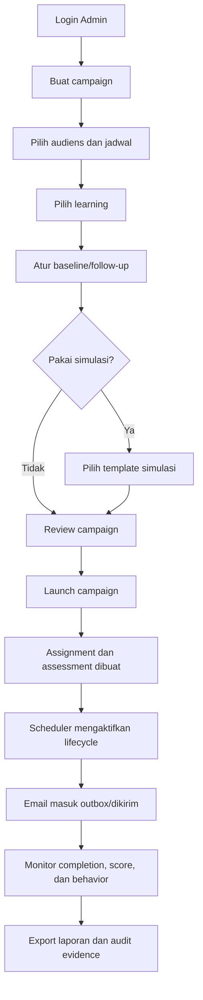
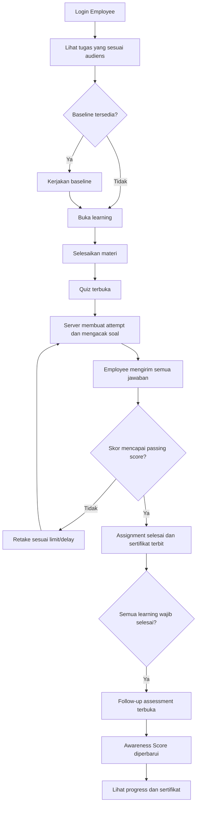
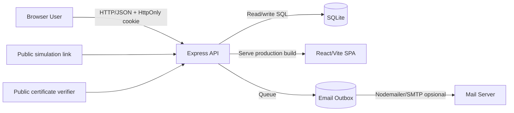
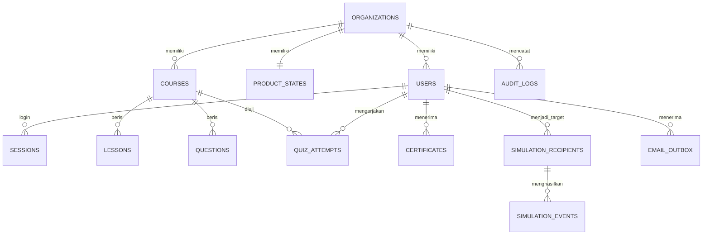

# Dokumentasi Historis AVERIS — Sebelum Product Maturity

> Arsip implementasi sebelumnya. Navigasi, API, formula, dan alur di sini bukan panduan versi aktif. Gunakan [Dokumentasi Lengkap](../DOKUMENTASI_LENGKAP.md) untuk workspace terbaru. Arsip dipertahankan untuk meninjau migrasi, bukan untuk mengaktifkan kembali API lama.

> **Security Awareness & Human Risk Platform**  
> **Measure Awareness. Reduce Human Risk.**  
> Produk: **AVERIS** oleh **VulneraX**  
> Versi aplikasi: `0.1.0`  
> Status dokumen: berdasarkan implementasi repository per 9 September 2026

---

## Daftar isi

1. [Ringkasan eksekutif](#1-ringkasan-eksekutif)
2. [Latar belakang dan tujuan](#2-latar-belakang-dan-tujuan)
3. [Pengguna dan model peran](#3-pengguna-dan-model-peran)
4. [Fitur lengkap](#4-fitur-lengkap)
5. [Alur bisnis utama](#5-alur-bisnis-utama)
6. [Awareness Score](#6-awareness-score)
7. [Arsitektur sistem](#7-arsitektur-sistem)
8. [Technology stack](#8-technology-stack)
9. [Struktur repository](#9-struktur-repository)
10. [Frontend](#10-frontend)
11. [Backend dan API](#11-backend-dan-api)
12. [Model data dan database](#12-model-data-dan-database)
13. [Autentikasi, otorisasi, dan keamanan](#13-autentikasi-otorisasi-dan-keamanan)
14. [Automation dan email](#14-automation-dan-email)
15. [Simulasi phishing](#15-simulasi-phishing)
16. [Pelaporan dan sertifikat](#16-pelaporan-dan-sertifikat)
17. [Instalasi dan menjalankan aplikasi](#17-instalasi-dan-menjalankan-aplikasi)
18. [Konfigurasi environment](#18-konfigurasi-environment)
19. [Build dan deployment](#19-build-dan-deployment)
20. [Testing dan quality assurance](#20-testing-dan-quality-assurance)
21. [Operasional dan troubleshooting](#21-operasional-dan-troubleshooting)
22. [Batasan implementasi saat ini](#22-batasan-implementasi-saat-ini)
23. [Rekomendasi pengembangan](#23-rekomendasi-pengembangan)
24. [Glosarium](#24-glosarium)

---

## 1. Ringkasan eksekutif

AVERIS adalah aplikasi web full-stack untuk membantu organisasi mengukur, memahami, dan meningkatkan kesadaran keamanan siber karyawan. Platform ini tidak berhenti pada metrik “training selesai”, tetapi menggabungkan hasil pengetahuan, perilaku terhadap simulasi phishing, kebiasaan pelaporan, dan peningkatan dari waktu ke waktu menjadi **Awareness Score** yang mudah dijelaskan.

Siklus nilai utama AVERIS adalah:

```text
Measure → Understand Risk → Take Action → Prove Improvement
 Ukur       Pahami risiko      Intervensi       Buktikan peningkatan
```

Secara praktis, administrator membuat campaign, menentukan audiens dan materi, menjalankan assessment serta simulasi phishing, memonitor penyelesaian, lalu mengekspor laporan. Karyawan mengerjakan pembelajaran dan kuis, melihat perkembangan awareness, melaporkan pesan mencurigakan, serta memperoleh sertifikat ketika lulus.

### Nilai bisnis utama

- Memberikan visibilitas atas risiko manusia, bukan hanya status kepatuhan.
- Menemukan topik atau kelompok yang membutuhkan intervensi.
- Menjalankan program awareness secara berulang dan terukur.
- Menyediakan bukti pelaksanaan melalui audit log, laporan, riwayat kuis, dan sertifikat.
- Mengarahkan pembelajaran berdasarkan risiko dan hasil aktual.
- Mendukung pemisahan data organisasi atau tenant.

### Cakupan implementasi

Aplikasi saat ini mencakup frontend React, REST API Express, SQLite, autentikasi berbasis cookie, role-based access control, pengelolaan pengguna dan konten, quiz engine server-side, automation lifecycle, email outbox, simulasi phishing aman, ekspor CSV/PDF, audit log, dan verifikasi sertifikat publik.

---

## 2. Latar belakang dan tujuan

### 2.1 Masalah yang diselesaikan

Program security awareness tradisional sering hanya menjawab pertanyaan “siapa yang sudah menyelesaikan training?”. Angka tersebut belum menjelaskan:

- apakah karyawan memahami materi;
- apakah mereka mampu mengenali serangan;
- apakah mereka akan melaporkan kejadian mencurigakan;
- departemen mana yang memiliki risiko paling besar;
- apakah program benar-benar menghasilkan peningkatan;
- tindakan lanjutan apa yang sebaiknya dilakukan.

AVERIS dirancang untuk menjawab pertanyaan tersebut dengan menghubungkan pembelajaran, assessment, simulasi, pelaporan, dan analitik dalam satu siklus.

### 2.2 Tujuan produk

1. Mengukur tingkat awareness individu dan organisasi.
2. Mengubah sinyal pembelajaran dan perilaku menjadi indikator risiko yang dapat dijelaskan.
3. Membantu tim Security/IT menjalankan campaign terarah.
4. Memberikan pengalaman belajar singkat dan jelas bagi karyawan.
5. Membuktikan peningkatan melalui baseline dan follow-up assessment.
6. Menyediakan evidence untuk audit dan kebutuhan compliance.

### 2.3 Target penggunaan

- Tim Information Security dan Security Awareness.
- Tim IT dan Governance, Risk & Compliance.
- HR/Learning & Development yang mengelola pelatihan keamanan.
- Manajer departemen yang memonitor risiko tim.
- Seluruh karyawan sebagai peserta pembelajaran.

---

## 3. Pengguna dan model peran

AVERIS memiliki empat peran.

| Peran | Fungsi utama | Batasan penting |
| --- | --- | --- |
| `super_admin` | Pemilik/pengelola tertinggi tenant | Dapat mengelola akun admin dan semua fungsi administratif |
| `admin` | Operator program awareness | Tidak boleh membuat atau mengelola akun Admin/Super Admin |
| `manager` | Pemantau dan pengelola terbatas | Dapat melihat laporan, user employee, membuat campaign/assignment; tidak dapat launch/close campaign atau mengubah user |
| `employee` | Peserta program | Hanya melihat data yang relevan dengan diri dan audiens/departemennya |

### 3.1 Matriks kapabilitas

| Kapabilitas | Super Admin | Admin | Manager | Employee |
| --- | :---: | :---: | :---: | :---: |
| Dashboard organisasi | ✓ | ✓ | ✓ | — |
| Daftar pengguna | ✓ | ✓ | Employee saja | — |
| Tambah/edit/nonaktifkan pengguna | ✓ | ✓, terbatas | — | — |
| Kelola akun Admin/Super Admin | ✓ | — | — | — |
| Import CSV pengguna | ✓ | ✓ | — | — |
| Membuat campaign | ✓ | ✓ | ✓ | — |
| Mengubah status/launch campaign | ✓ | ✓ | — | — |
| Assign learning langsung | ✓ | ✓ | ✓ | — |
| Melihat konten dan bank soal | ✓ | ✓ | ✓ | — |
| Membuat/mengubah konten | ✓ | ✓ | — | — |
| Menjalankan scheduler/proses email manual | ✓ | ✓ | — | — |
| Melihat automation/outbox | ✓ | ✓ | ✓ | — |
| Melihat report dan export | ✓ | ✓ | ✓ | — |
| Melihat audit log tenant | ✓ | ✓ | ✓ | — |
| Mengakses integrations/settings | ✓ | ✓ | — | — |
| Menyelesaikan learning/quiz/assessment | — | — | — | ✓ |
| Melihat sertifikat pribadi | — | — | — | ✓ |
| Melaporkan phishing | — | — | — | ✓ |

> Kontrol route di frontend digunakan untuk pengalaman pengguna. Otorisasi yang menentukan keamanan tetap ditegakkan kembali oleh backend.

---

## 4. Fitur lengkap

### 4.1 Dashboard dan overview

- Ringkasan jumlah employee, campaign aktif, attempt, completion/pass rate, dan average score.
- Tampilan Awareness Score organisasi serta perbandingan dengan periode sebelumnya.
- Breakdown per departemen.
- Filter periode, departemen, campaign, dan tingkat risiko.
- Data dashboard dihitung oleh backend dari user, quiz attempt, dan product state tenant.

### 4.2 People management

- Melihat daftar user dalam organisasi.
- Pencarian berdasarkan nama/email dan filter departemen di UI.
- Membuat user beserta temporary password.
- Mengubah nama, email, departemen, role, dan status aktif.
- Menonaktifkan akun sekaligus mencabut seluruh sesi user tersebut.
- Mencegah user menonaktifkan akunnya sendiri.
- Import maksimal 5.000 baris per file CSV.
- Hasil import berisi daftar sukses, error per baris, dan temporary password yang hanya ditampilkan dalam respons import.

Format CSV:

```csv
email,name,department,role
employee@example.com,Employee Name,Finance,employee
manager@example.com,Manager Name,Finance,manager
```

Role yang diizinkan melalui import adalah `employee` dan `manager`.

### 4.3 Campaign management

Campaign merupakan wadah program awareness yang menyatukan:

- nama dan objektif;
- owner;
- audiens;
- jumlah target employee;
- jadwal dan tenggat;
- satu atau lebih learning;
- baseline/follow-up assessment;
- simulasi phishing opsional;
- status, completion, baseline score, dan final score.

Status campaign:

```text
Draft ───────→ Scheduled ───────→ Active ───────→ Completed ───────→ Closed
  │               │                  │                                  
  └───────────────┴──────────────────┴────────────→ Cancelled
                                                    │
                                                    └──→ Draft
```

Transisi yang diizinkan backend:

| Status awal | Status berikutnya yang diizinkan |
| --- | --- |
| Draft | Scheduled, Cancelled |
| Scheduled | Draft, Active, Cancelled |
| Active | Completed, Closed, Cancelled |
| Completed | Closed |
| Closed | Tidak ada |
| Cancelled | Draft |

Saat campaign diluncurkan:

1. Assignment dibuat untuk setiap learning.
2. Baseline dibuat jika `baselineEnabled` aktif.
3. Follow-up dibuat dengan status `Locked` jika `followUpEnabled` aktif.
4. Simulasi dibuat dengan status `Scheduled` jika dipilih.
5. Campaign menjadi `Scheduled` bila tanggal mulai masih di masa depan; selain itu menjadi `Active`.
6. Notification dan event aktivitas dicatat pada product state.

### 4.4 Learning management system

- Katalog course per tenant.
- Course memiliki judul, kategori, deskripsi, durasi, passing score, batas attempt, retry delay, pengacakan soal, dan status aktif.
- Course berisi daftar lesson dan bank pertanyaan.
- Employee hanya dapat memulai materi yang ditugaskan ke audiensnya.
- Progress dapat bergerak dari `Not Started` → `In Progress` → `Quiz Available` → `Completed`.
- Assignment dapat berubah menjadi `Overdue` oleh scheduler.
- Pengalaman learning menggunakan player tanpa application shell agar fokus pada materi.

### 4.5 Assessment dan quiz

- Baseline assessment untuk mengukur kondisi awal.
- Follow-up assessment terkunci sampai semua learning wajib dalam campaign selesai.
- Quiz course dibuat dan dinilai di server.
- Urutan pertanyaan dapat diacak per attempt.
- Kunci jawaban tidak dikirim ke employee.
- Attempt dipisahkan berdasarkan kombinasi tenant, user, campaign, course, dan nomor attempt.
- Batas jumlah attempt dan waktu tunggu retake dikontrol dari konfigurasi course.
- Semua pertanyaan wajib dijawab saat submit.
- Lulus ditentukan oleh `score >= passingScore`.
- Attempt sukses dapat menerbitkan sertifikat.

### 4.6 Awareness dan human risk

- Awareness Score individu dan organisasi dengan skala 0–100.
- Perbandingan current vs previous score.
- Topic breakdown untuk menunjukkan area kuat dan lemah.
- Segmentasi laporan berdasarkan risiko:
  - `high`: belum memiliki skor atau skor di bawah 60;
  - `medium`: skor 60–79;
  - `low`: skor 80 ke atas.
- Pesan produk menegaskan skor sebagai panduan belajar, bukan penilaian performa kerja.

### 4.7 Simulasi phishing aman

- Template simulasi: Password Expiration, Shared Document Invitation, dan Delivery Notification.
- Tracking event publik menggunakan token acak yang hanya disimpan sebagai hash.
- Event aman yang diterima endpoint publik: `opened`, `clicked`, `reported`, dan `no_action`.
- Tidak ada pengumpulan password atau kredensial nyata.
- IP disimpan dalam bentuk hash, bukan alamat mentah.
- Event yang sama untuk recipient yang sama dibuat idempotent.
- Administrator dapat melihat event per campaign.

### 4.8 Automation dan notification outbox

- Worker berjalan otomatis setiap satu menit.
- Mengaktifkan campaign terjadwal ketika waktu mulai tiba.
- Menyelesaikan campaign aktif ketika melewati end date.
- Menandai assignment yang melewati tenggat sebagai overdue.
- Membuat email assignment, due reminder, overdue reminder, dan simulasi.
- Semua pesan masuk ke outbox tenant sebelum dikirim.
- Tanpa SMTP, pesan tetap tersimpan dan tidak dikirim secara tidak sengaja.
- Pengiriman yang gagal dapat dicoba ulang sampai lima kali.
- Admin dapat menjalankan scheduler dan proses outbox secara manual.

### 4.9 Reporting dan export

- Filter laporan: 7, 30, 90, 365 hari, atau seluruh waktu.
- Filter departemen, campaign, dan risk level.
- Ringkasan user, active campaign, quiz attempt, completion/pass rate, dan average score.
- Breakdown departemen.
- Export employee report ke CSV UTF-8.
- Export executive summary ke PDF A4.

### 4.10 Audit log

- Mencatat aktivitas autentikasi, perubahan user, aksi produk, content, quiz, simulation, dan scheduler.
- Outcome: `success`, `failure`, atau `denied`.
- Menyimpan actor, entity, metadata, IP, user agent, dan timestamp bila tersedia.
- Query tenant-scoped, paginated, dan dapat difilter berdasarkan action.

### 4.11 Sertifikat

- Dibuat ketika employee lulus quiz.
- Unik per tenant, user, dan course.
- Status `Issued` atau `Revoked` pada tabel relasional.
- Halaman sertifikat employee mendukung tampilan siap cetak/download melalui browser.
- Endpoint verifikasi sertifikat tersedia tanpa login.
- Sertifikat revoked atau tidak dikenal dikembalikan sebagai not found/tidak berlaku.

### 4.12 Internationalization dan responsive UI

- Selector bahasa Inggris (`EN`) dan Indonesia (`ID`).
- Bahasa disimpan/dikelola oleh modul `i18n.ts` dan diterapkan pada elemen antarmuka.
- Sidebar responsif dengan mobile menu.
- Error boundary mencegah kegagalan komponen menjatuhkan seluruh halaman tanpa pesan.
- Komponen loading, empty state, global error, status badge, score badge, dan progress indicator digunakan konsisten.

---

## 5. Alur bisnis utama

### 5.1 Alur administrator menjalankan campaign



### 5.2 Alur employee



### 5.3 Alur autentikasi

1. User mengirim email, password, dan opsi remember me.
2. Backend menormalisasi email dan memvalidasi format input.
3. Backend membandingkan password dengan bcrypt hash.
4. Jika valid, server membuat token sesi acak 32-byte.
5. Browser menerima token melalui cookie `HttpOnly` bernama `averis_session`.
6. Database hanya menyimpan HMAC-SHA256 token, bukan token mentah.
7. Setiap request terproteksi mencari sesi aktif dan user aktif.
8. Identitas tenant selalu diambil dari sesi, bukan input client.
9. Sesi berlaku 12 jam atau 30 hari jika remember me dipilih.

### 5.4 Alur simulasi phishing

1. Campaign aktif menentukan employee berdasarkan audiens.
2. Scheduler membuat recipient dan token unik per user/campaign.
3. Token mentah hanya dimasukkan ke link email; database menyimpan hash.
4. Employee membuka landing page simulasi.
5. Event aman dikirim ke endpoint publik.
6. Backend memvalidasi token, mencegah duplikasi, dan menyimpan hash IP.
7. Counter simulation serta audit log diperbarui.
8. `reported` meningkatkan behavior/reporting signal; `clicked` menurunkan behavior signal pada alur aksi produk internal.

---

## 6. Awareness Score

### 6.1 Formula

Implementasi `server/product-actions.mjs` menggunakan formula:

```text
Awareness Score =
  (Knowledge × 35%) +
  (Behavior × 30%) +
  (Reporting × 20%) +
  (Improvement × 15%)
```

Hasil dibulatkan ke bilangan bulat.

| Sinyal | Bobot | Sumber perubahan dalam implementasi |
| --- | ---: | --- |
| Knowledge | 35% | Hasil quiz dan assessment |
| Behavior | 30% | Respons terhadap simulasi phishing |
| Reporting | 20% | Pelaporan pesan mencurigakan/simulasi |
| Improvement | 15% | Kelulusan dan follow-up assessment |

### 6.2 Perubahan sinyal

- Quiz memperbarui knowledge dengan rata-rata antara nilai sebelumnya dan skor quiz.
- Quiz lulus menambah improvement maksimal sampai 100.
- Follow-up assessment menambah improvement.
- Simulation reported menambah behavior dan reporting.
- Simulation clicked atau credential-attempted pada aksi internal menurunkan behavior.
- Report phishing menambah reporting.

### 6.3 Interpretasi risiko laporan

| Skor | Segmentasi report | Interpretasi umum UI |
| ---: | --- | --- |
| 80–100 | Low risk | Strong |
| 60–79 | Medium risk | Good/Needs Improvement tergantung helper UI |
| 0–59 atau tanpa skor | High risk | Prioritas intervensi |

> Formula saat ini bersifat rule-based dan explainable. Untuk penggunaan produksi, governance skor, kalibrasi bobot, minimum sample, dan perlakuan terhadap user tanpa data perlu disetujui secara formal.

---

## 7. Arsitektur sistem

### 7.1 Diagram konteks



### 7.2 Pola arsitektur

- **Single-page application:** React Router menangani navigasi client-side.
- **REST-style API:** endpoint `/api/*` menangani autentikasi, data, mutation, report, dan export.
- **Same-origin production:** Express menyajikan `dist` serta fallback `index.html`.
- **Development proxy:** Vite pada port 4173 meneruskan `/api` ke Express port 3001.
- **Server-owned state:** frontend memuat state dari API dan tidak lagi menggunakan localStorage untuk state bisnis.
- **Hybrid persistence:** domain inti campaign/assignment/assessment tersimpan sebagai JSON per tenant; identity, content, attempt, outbox, simulation event, audit, dan certificate tersimpan pada tabel relasional.
- **Tenant isolation:** `organization_id` ditentukan dari authenticated session di backend.
- **Background lifecycle:** timer in-process menjalankan scheduler dan email processor.

### 7.3 Alur request data

```text
UI Component
  → React Context (AuthProvider/ProductProvider)
  → apiRequest() dengan credentials: include
  → Express middleware (origin, auth, role, validation)
  → business action / SQL transaction
  → SQLite
  → response JSON terfilter berdasarkan role
  → React state diperbarui dan UI render ulang
```

---

## 8. Technology stack

### 8.1 Frontend

| Teknologi | Kegunaan |
| --- | --- |
| React | Library UI berbasis komponen |
| React DOM | Rendering aplikasi ke browser |
| TypeScript | Type safety untuk frontend |
| React Router DOM | Routing, protected route, parameter route, redirect |
| Vite | Development server, proxy, dan production bundling |
| Lucide React | Ikon antarmuka |
| Recharts | Visualisasi/chart pada dashboard dan report |
| CSS modular per layer | Styling dasar, experience, flow, mature, polish, dan UX refresh |

### 8.2 Backend

| Teknologi | Kegunaan |
| --- | --- |
| Node.js ESM | Runtime server |
| Express 5 | HTTP server dan REST API |
| better-sqlite3 | Database SQLite sinkron dan transaksi |
| bcryptjs | Hash dan verifikasi password dengan cost 12 |
| Zod | Validasi body/query dan field errors |
| Helmet | Security headers dan production CSP |
| express-rate-limit | Rate limit login |
| cookie-parser | Membaca session cookie |
| Nodemailer | Pengiriman email melalui SMTP |
| csv-parse | Parsing onboarding CSV |
| PDFKit | Pembuatan report PDF |
| Node Crypto | Random token/UUID, HMAC, dan hashing |

### 8.3 Tooling

- `concurrently` menjalankan API dan web secara bersamaan.
- TypeScript project build memastikan pemeriksaan tipe sebelum bundling.
- Node built-in test runner menjalankan integration/security tests.
- npm lockfile menjaga resolusi dependency konsisten.

---

## 9. Struktur repository

```text
.
├── src/
│   ├── main.tsx                 # Entry point React dan provider
│   ├── App.tsx                  # Route map dan protected route
│   ├── auth.tsx                 # Auth context dan lifecycle sesi
│   ├── product-state.tsx        # Product context dan mutation API
│   ├── api.ts                   # HTTP client dan download helper
│   ├── types.ts                 # Tipe role, employee, course, API error
│   ├── components.tsx           # App shell dan komponen UI bersama
│   ├── AdminPages.tsx           # Halaman admin legacy/presentation
│   ├── ProductPages.tsx         # Campaign, awareness, settings, audit
│   ├── EmployeePages.tsx        # Halaman employee dan visual learning
│   ├── ConnectedExperience.tsx  # Halaman yang terhubung product state
│   ├── EnterpriseFeatures.tsx   # People, CMS, quiz server, report, automation
│   ├── RefinedExperience.tsx    # Learning/certificate/simulation refined UI
│   ├── ErrorBoundary.tsx        # Global UI error boundary
│   ├── data.ts                  # Data tampilan/katalog pendukung
│   ├── i18n.ts                  # Kamus dan penggantian bahasa
│   └── *.css                    # Lapisan styling aplikasi
├── server/
│   ├── index.mjs                # Bootstrap Express, auth, core API, middleware
│   ├── db.mjs                   # Schema, seed, migration, state, audit
│   ├── platform.mjs             # User/CMS/quiz/automation/report/public API
│   ├── product-actions.mjs      # Domain mutation dan kalkulasi score
│   ├── seed-data.mjs            # Initial product state dan course catalog
│   └── security.test.mjs        # Integration/security test suite
├── .env.example                 # Contoh konfigurasi runtime
├── vite.config.ts               # Vite dan dev proxy
├── tsconfig*.json               # Konfigurasi TypeScript
├── package.json                 # Script dan dependency
├── index.html                   # HTML entry point
├── README.md                    # Overview singkat
└── DOKUMENTASI_LENGKAP.md       # Dokumen ini
```

Folder runtime/build:

- `.data/`: default lokasi SQLite; bukan source code.
- `dist/`: hasil production build Vite.
- `node_modules/`: dependency lokal.

---

## 10. Frontend

### 10.1 Provider dan state

Urutan provider pada `main.tsx`:

```text
React.StrictMode
└── ErrorBoundary
    └── BrowserRouter
        └── AuthProvider
            └── ProductProvider
                └── App
```

`AuthProvider`:

- memanggil `/api/auth/me` ketika aplikasi dibuka;
- menyimpan user aktif di memory;
- menyediakan `login`, `logout`, dan `refresh`;
- membersihkan user ketika HTTP client menerima 401.

`ProductProvider`:

- mengambil `/api/product-state` setelah user terautentikasi;
- menyimpan product state per user aktif;
- menyediakan mutation campaign, learning, assessment, simulation, dan report phishing;
- mengganti state lokal menggunakan respons canonical dari server;
- menampilkan status loading, pending, dan error.

### 10.2 Route publik

| Route | Halaman | Fungsi |
| --- | --- | --- |
| `/` | Login | Autentikasi dan pilihan bahasa |
| `/verify/:certificateId?` | Certificate Verification | Verifikasi sertifikat tanpa login |
| `/simulation/:token` | Simulation Landing | Mencatat event simulasi aman |

### 10.3 Route admin/manager

| Route | Fungsi |
| --- | --- |
| `/admin` | Overview/report dashboard |
| `/admin/employees` | People management |
| `/admin/employees/:employeeId` | Detail employee |
| `/admin/campaigns` | Daftar campaign |
| `/admin/campaigns/new` | Campaign builder |
| `/admin/campaigns/:campaignId` | Detail campaign |
| `/admin/campaigns/:campaignId/simulation-preview` | Preview dan uji event simulasi |
| `/admin/learning` | Learning library |
| `/admin/learning/:courseId` | Detail course |
| `/admin/content` | Content management dan question bank |
| `/admin/automation` | Scheduler, SMTP status, dan outbox |
| `/admin/awareness` | Human-risk overview |
| `/admin/awareness/methodology` | Penjelasan metodologi score |
| `/admin/audit` | Audit log |
| `/admin/reports` | Report terfilter dan export |
| `/admin/reports/:reportId` | Detail report |
| `/admin/integrations` | Struktur integrasi, Admin/Super Admin saja |
| `/admin/settings` | Settings, Admin/Super Admin saja |

### 10.4 Route employee

| Route | Fungsi |
| --- | --- |
| `/employee` | Home dan next action |
| `/employee/learning` | Daftar assignment learning |
| `/employee/learning/:campaignId/:courseId` | Learning player dengan konteks campaign |
| `/employee/learning/:courseId` | Learning player legacy/tanpa parameter campaign |
| `/employee/quiz/:campaignId/:courseId` | Quiz server-side scoped ke campaign |
| `/employee/quiz/:campaignId/:courseId/result` | Hasil quiz |
| `/employee/quiz/:campaignId/:courseId/review` | Review jawaban |
| `/employee/awareness` | Score dan perkembangan pribadi |
| `/employee/assessment/:assessmentId` | Baseline/follow-up assessment |
| `/employee/certificates` | Daftar sertifikat pribadi |
| `/employee/certificates/:courseId` | Detail sertifikat siap cetak |

Route `/employee/programs*` saat ini dialihkan ke `/employee/learning`.

### 10.5 Penanganan error

- Network failure dikonversi menjadi `ApiError` dengan `NETWORK_ERROR`.
- Error API mengikuti struktur seragam.
- HTTP 401 memicu event `averis:unauthorized` untuk mengosongkan sesi frontend.
- Protected route menampilkan loading, retry, atau redirect sesuai kondisi.
- Error mutation ditampilkan melalui global error banner.

---

## 11. Backend dan API

### 11.1 Konvensi umum

- Base path: `/api`.
- Body request: JSON kecuali download.
- Sesi: cookie `averis_session`.
- Response error:

```json
{
  "error": {
    "code": "VALIDATION_ERROR",
    "message": "Periksa kembali data yang dikirim.",
    "fields": {
      "campaign.name": "Too small"
    }
  }
}
```

- Tenant tidak boleh dipilih melalui body/query; selalu berasal dari session.
- Mutation product utama dijalankan dalam transaksi database.

### 11.2 Health dan autentikasi

| Method | Endpoint | Akses | Fungsi |
| --- | --- | --- | --- |
| GET | `/api/health` | Publik | Status server, path database, waktu |
| POST | `/api/auth/login` | Publik | Login dan membuat session cookie |
| GET | `/api/auth/me` | Login | Mengambil identitas sesi |
| POST | `/api/auth/logout` | Login | Menghapus sesi aktif |
| POST | `/api/auth/change-password` | Login | Mengganti password dan mencabut sesi lain |

Contoh login:

```json
{
  "email": "andini@acme.co.id",
  "password": "password-rahasia",
  "rememberMe": false
}
```

Password baru minimal 12 karakter dan wajib memuat huruf kecil, huruf besar, angka, serta simbol.

### 11.3 Product state dan actions

| Method | Endpoint | Akses |
| --- | --- | --- |
| GET | `/api/product-state` | Semua user login; hasil employee difilter |
| POST | `/api/product-actions/:action` | Bergantung action/role |

Action yang tersedia:

| Action | Role | Tujuan |
| --- | --- | --- |
| `createCampaign` | Super Admin, Admin, Manager | Membuat campaign |
| `updateCampaignStatus` | Super Admin, Admin | Mengubah lifecycle campaign |
| `launchCampaign` | Super Admin, Admin | Membuat assignment/assessment/simulation |
| `assignLearning` | Super Admin, Admin, Manager | Membuat assignment langsung |
| `startLearning` | Employee | Memulai assignment |
| `updateLearningProgress` | Employee | Menyimpan progress 0–100 |
| `completeLearningContent` | Employee | Membuka quiz |
| `completeModuleQuiz` | Employee | Mutation kompatibilitas; quiz utama memakai endpoint khusus |
| `completePhishingQuiz` | Employee | Alur quiz demo/legacy |
| `startAssessment` | Employee | Memulai assessment available |
| `completeAssessment` | Employee | Menilai assessment dan memperbarui score |
| `recordSimulationEvent` | Super Admin, Admin, Manager | Preview/admin simulation event |
| `reportPhishing` | Employee | Menambah sinyal pelaporan |
| `resetDemo` | Super Admin, Admin | Mengembalikan product state ke seed |

### 11.4 User management

| Method | Endpoint | Role | Fungsi |
| --- | --- | --- | --- |
| GET | `/api/admin/users` | Viewer roles | Daftar user tenant; manager hanya employee |
| POST | `/api/admin/users` | Super Admin, Admin | Membuat user |
| PATCH | `/api/admin/users/:id` | Super Admin, Admin | Update/deaktivasi user |
| POST | `/api/admin/users/import` | Super Admin, Admin | Import CSV |

### 11.5 Content management

| Method | Endpoint | Role | Fungsi |
| --- | --- | --- | --- |
| GET | `/api/admin/content/courses` | Super Admin, Admin, Manager | Daftar course dan jumlah lesson/question |
| GET | `/api/admin/content/courses/:id` | Super Admin, Admin, Manager | Detail beserta answer key |
| POST | `/api/admin/content/courses` | Super Admin, Admin | Membuat course |
| PUT | `/api/admin/content/courses/:id` | Super Admin, Admin | Mengganti isi course |

Saat course diperbarui, lesson dan question lama dihapus lalu dibuat ulang di dalam transaksi. Validasi membatasi maksimal 100 lesson, 200 question, 2–10 opsi per question, dan memastikan `correctIndex` menunjuk opsi yang valid.

### 11.6 Quiz API

| Method | Endpoint | Role | Fungsi |
| --- | --- | --- | --- |
| GET | `/api/quiz/:courseId?campaignId=...` | Employee | Mengambil/membuat attempt |
| POST | `/api/quiz/:courseId/submit?campaignId=...` | Employee | Menilai jawaban di server |
| GET | `/api/quiz/:courseId/history?campaignId=...` | Employee | Riwayat attempt sendiri |

Server hanya mengirim `id`, prompt, opsi, dan metadata pertanyaan kepada employee. `correctIndex` hanya tersedia pada endpoint CMS untuk role viewer admin.

### 11.7 Automation, simulation, report, dan audit

| Method | Endpoint | Akses | Fungsi |
| --- | --- | --- | --- |
| GET | `/api/admin/automation` | Viewer roles | Status SMTP dan 100 item outbox terbaru |
| POST | `/api/admin/scheduler/run` | Super Admin, Admin | Menjalankan lifecycle manual |
| POST | `/api/admin/email/process` | Super Admin, Admin | Memproses maksimal 25 email |
| POST | `/api/public/simulations/:token/event` | Publik bertoken | Mencatat safe event |
| GET | `/api/admin/simulations/:campaignId/events` | Viewer roles | Event simulasi campaign |
| GET | `/api/admin/dashboard` | Viewer roles | Dataset laporan |
| GET | `/api/admin/export/employees.csv` | Viewer roles | Download CSV |
| GET | `/api/admin/export/report.pdf` | Viewer roles | Download PDF |
| GET | `/api/public/certificates/:id` | Publik | Verifikasi sertifikat |
| GET | `/api/audit-logs` | Viewer roles | Audit log paginated |

Query report:

- `period`: `7`, `30`, `90`, `365`, atau `all`;
- `department`: nama departemen;
- `campaignId`: ID campaign;
- `risk`: `high`, `medium`, atau `low`.

Query audit:

- `page`: minimal 1, default 1;
- `limit`: 1–100, default 30;
- `action`: pencarian parsial action.

---

## 12. Model data dan database

### 12.1 Konfigurasi SQLite

- Default file: `.data/averis.sqlite`.
- `journal_mode = WAL` untuk concurrency baca/tulis yang lebih baik.
- Foreign key enforcement aktif.
- `busy_timeout = 5000` ms.
- Folder database dibuat otomatis.
- Schema dan seed dijalankan ketika modul database dimuat.

### 12.2 Relasi utama



### 12.3 Tabel

#### `organizations`

Identitas tenant: `id`, `name`, `slug`, `industry`, dan waktu pembuatan.

#### `users`

Identitas login dan profil organisasi: email, password hash, nama, role, department, active, serta timestamp. Role dibatasi oleh check constraint.

#### `sessions`

Menyimpan HMAC token, user, expiry, created/last seen, IP, dan user agent. Session terhapus cascade jika user dihapus.

#### `product_states`

Satu dokumen JSON per organisasi untuk campaign, assignment, assessment, score signals, notification, simulation summary, dan event produk. Kolom `version` bertambah setiap penyimpanan.

#### `audit_logs`

Log keamanan dan aktivitas dengan outcome, metadata JSON, actor, entity, IP, user agent, serta waktu.

#### `courses`, `lessons`, `questions`

CMS learning tenant-scoped. Pertanyaan menyimpan opsi dalam JSON dan answer key sebagai index.

#### `quiz_attempts`

Attempt quiz yang terikat user, tenant, campaign, dan course. Menyimpan order pertanyaan, jawaban, score, status lulus, waktu mulai/selesai, dan waktu retake berikutnya.

#### `email_outbox`

Antrean pesan dengan template, recipient, subject/body, status, attempts, jadwal, error terakhir, dan idempotency key unik.

#### `simulation_recipients`, `simulation_events`

Recipient menyimpan hash token unik. Event menyimpan event aman, hash IP, user agent, dan timestamp.

#### `certificates`

Sertifikat relasional dengan status issued/revoked, score, course, user, dan issue time.

### 12.4 Seed data

First run membuat:

- satu organisasi default `ACME Indonesia`;
- empat akun bootstrap: Super Admin, Admin, Manager, Employee;
- tujuh course security awareness;
- satu lesson default dan lima pertanyaan template untuk setiap course;
- initial product state berisi contoh campaign, assignment, assessment, simulation, score, dan sertifikat.

Course bawaan:

1. Phishing Awareness
2. Password & Account Security
3. Social Engineering
4. Data Protection Basics
5. Safe Browsing & Device Security
6. Business Email Compromise
7. Secure Remote Working

Jika password bootstrap tidak diisi sebelum first run, password random kuat dicetak sekali pada console. Password tersebut tidak dikirim ke frontend.

---

## 13. Autentikasi, otorisasi, dan keamanan

### 13.1 Kontrol yang telah diterapkan

- Password disimpan dengan bcrypt cost factor 12.
- Dummy password hash tetap dibandingkan pada login untuk mengurangi perbedaan jalur user ada/tidak ada.
- Login dibatasi 10 kegagalan per 15 menit; request sukses tidak dihitung.
- Session token dibuat dengan CSPRNG 32 byte.
- Hanya keyed HMAC-SHA256 token yang disimpan di database.
- Cookie bersifat `HttpOnly`, `SameSite=Strict`, path `/`, dan `Secure` di production.
- Durasi sesi 12 jam; remember me 30 hari.
- Session expiry diperiksa pada setiap request dan sesi kedaluwarsa dibersihkan periodik setiap jam.
- Change password mencabut semua sesi lain milik user.
- Deaktivasi user mencabut semua sesinya.
- Helmet mengaktifkan security headers.
- Production CSP membatasi script/connect/image/font/frame/object/form source.
- `x-powered-by` dinonaktifkan.
- Mutation memeriksa Origin terhadap same-origin dan `ALLOWED_ORIGINS`.
- Body JSON dibatasi 128 KB; endpoint import membatasi string CSV sampai 2 MB dan 5.000 baris.
- Zod strict schema menolak field/format yang tidak sesuai.
- RBAC diperiksa backend pada route dan product action.
- Tenant berasal dari session dan dipakai pada query database.
- Employee product state difilter berdasarkan audience, nama, dan actor.
- Answer key quiz tidak diberikan kepada employee.
- Simulation tidak menerima `credentialAttempted` melalui endpoint publik.
- Token simulation dan IP address di-hash.
- Security-relevant action dicatat dalam audit log.
- Production menolak `SESSION_SECRET` yang kosong, kurang dari 32 karakter, atau masih memakai placeholder.

### 13.2 Origin control

Untuk method selain GET/HEAD/OPTIONS, request dengan header `Origin` hanya diterima bila berasal dari:

- origin request yang sama;
- daftar `ALLOWED_ORIGINS`;
- `localhost:4173`/`127.0.0.1:4173` dalam development.

Request non-browser tanpa header Origin tetap diteruskan. Karena itu, cookie `SameSite=Strict`, autentikasi, dan kontrol jaringan tetap penting.

### 13.3 Tenant isolation

Aturan desain utama:

```text
Client tidak dipercaya untuk memilih organization_id.
organization_id = req.auth.organization.id dari session server.
```

Filter ini diterapkan pada product state, users, content, quiz, reports, outbox, simulation events, dan audit logs.

### 13.4 Catatan hardening produksi

Sebelum internet-facing production, tambahkan atau verifikasi:

- reverse proxy HTTPS dan HSTS policy yang sesuai;
- centralized session store/database yang mendukung skala dan revocation;
- secret manager dan rotasi `SESSION_SECRET`/SMTP credential;
- MFA/SSO untuk akun administratif;
- password reset bertoken dan verifikasi email;
- backup terenkripsi, restore drill, retention, dan disaster recovery;
- monitoring, alerting, structured logs, dan tamper-resistant audit export;
- rate limit untuk endpoint publik lain, bukan hanya login;
- schema migration tool formal;
- data retention dan privacy policy untuk telemetry simulasi;
- penetration testing, dependency scanning, SAST/DAST, dan threat modeling;
- sanitasi/escaping konten CMS bila kelak dirender sebagai HTML;
- CSRF token defense-in-depth bila arsitektur cross-site berubah.

---

## 14. Automation dan email

### 14.1 Scheduler

Scheduler berjalan saat server start dan setiap 60 detik. Pekerjaan yang dilakukan:

1. Menemukan campaign `Scheduled` yang sudah mencapai start date lalu mengubahnya menjadi `Active`.
2. Menemukan campaign `Active` yang melewati end date lalu mengubahnya menjadi `Completed`.
3. Mengaktifkan/menyelesaikan simulation bersama lifecycle campaign.
4. Mengantrekan assignment email bagi semua employee yang cocok dengan audience.
5. Membuat simulation recipient dan link token unik.
6. Menandai assignment lewat tenggat sebagai `Overdue`.
7. Membuat overdue reminder harian.
8. Membuat due reminder jika tenggat berada dalam tiga hari.
9. Mencatat eksekusi scheduler ke audit log.

Idempotency key mencegah email assignment/simulation yang sama dibuat lebih dari sekali. Reminder memakai tanggal sebagai bagian key sehingga dapat dibuat satu kali per hari.

### 14.2 Email processor

- Mengambil pesan berstatus `queued` atau `failed`.
- Hanya memproses pesan dengan `attempts < 5` dan `scheduled_for <= now`.
- Mengubah status menjadi `sending`, lalu `sent` atau `failed`.
- Menyimpan `sent_at` atau error terakhir maksimal 500 karakter.
- Pemrosesan otomatis lintas tenant atau manual tenant-scoped.

### 14.3 Mode tanpa SMTP

Jika `SMTP_HOST` kosong, processor mengembalikan `configured: false` dan tidak mengirim pesan. Outbox tetap dapat diperiksa melalui halaman Automation. Mode ini aman untuk development/demo.

---

## 15. Simulasi phishing

AVERIS menggunakan prinsip safe simulation:

- link berisi token acak berentropi tinggi;
- token tidak tersimpan secara plaintext;
- halaman tidak meminta atau menyimpan kredensial;
- endpoint publik hanya menerima event aman;
- token invalid tetap mendapat respons 202 generik agar tidak mudah dienumerasi;
- event duplikat juga mendapat respons 202;
- alamat IP dipseudonimkan dengan keyed input sebelum disimpan;
- aktivitas tercatat untuk analitik dan audit.

Metrik simulation summary:

- `delivered`;
- `opened`;
- `clicked`;
- `reported`;
- `noAction`;
- `credentialAttempted` masih ada pada model/state kompatibilitas dan preview internal, tetapi ditolak oleh endpoint publik.

---

## 16. Pelaporan dan sertifikat

### 16.1 Definisi metrik laporan

- **Employees:** user aktif dengan role employee setelah filter.
- **Active campaigns:** jumlah campaign berstatus Active pada product state.
- **Attempts:** attempt quiz completed dalam periode/filter.
- **Completion:** persentase attempt yang passed, bukan persentase assignment selesai.
- **Score:** rata-rata score attempt yang cocok.
- **Department score:** rata-rata score attempt user pada departemen tersebut.

Definisi ini penting agar pembaca tidak menyamakan pass rate attempt dengan completion rate campaign.

### 16.2 CSV

Kolom export: Name, Email, Department, Active, Latest score, Passed. File diberi UTF-8 BOM untuk kompatibilitas spreadsheet dan nama tanggal otomatis.

### 16.3 PDF

PDF A4 memuat nama organisasi, waktu pembuatan, ringkasan metrik, dan breakdown departemen.

### 16.4 Verifikasi sertifikat

Consumer memasukkan ID sertifikat atau membuka `/verify/:certificateId`. Backend hanya mengembalikan sertifikat yang statusnya `Issued`, berisi ID, course, score, waktu terbit, nama employee, nama organisasi, dan flag `valid: true`.

---

## 17. Instalasi dan menjalankan aplikasi

### 17.1 Prasyarat

- Node.js versi modern yang mendukung ESM, built-in test runner, `fetch`, dan dependency native `better-sqlite3`.
- npm.
- Toolchain kompilasi native bila platform tidak menyediakan binary `better-sqlite3` yang cocok.
- SMTP hanya jika email sungguhan ingin dikirim.

### 17.2 Setup development

```bash
cp .env.example .env
npm install
npm run dev
```

Lalu buka:

- Web: `http://localhost:4173`
- API: `http://127.0.0.1:3001`
- Health: `http://127.0.0.1:3001/api/health`

`npm run dev` menjalankan dua process:

- `npm run dev:api`: Express dengan Node watch mode;
- `npm run dev:web`: Vite development server.

### 17.3 First run

1. Isi `SESSION_SECRET` dan seluruh password bootstrap di `.env`.
2. Jalankan server.
3. Database dan schema dibuat otomatis.
4. Organisasi, user bootstrap, course, dan state awal dibuat jika belum ada.
5. Jika password tidak diisi, salin password random dari console dan simpan melalui kanal rahasia yang disetujui.

> Nilai bootstrap hanya dipakai ketika record belum ada. Mengubah password di `.env` setelah user terbentuk tidak otomatis mengganti password database.

### 17.4 Script npm

| Command | Fungsi |
| --- | --- |
| `npm run dev` | Menjalankan API dan frontend development |
| `npm run dev:api` | Menjalankan backend dengan watch mode |
| `npm run dev:web` | Menjalankan Vite |
| `npm run build` | Type-check dan build frontend ke `dist` |
| `npm start` | Menjalankan Express dalam `NODE_ENV=production` |
| `npm run preview` | Preview build Vite pada port 4173 |
| `npm run check:server` | Syntax check seluruh modul backend utama |
| `npm test` | Menjalankan integration/security tests |

---

## 18. Konfigurasi environment

| Variable | Default/contoh | Wajib | Keterangan |
| --- | --- | --- | --- |
| `NODE_ENV` | development | Production runtime | `production` mengaktifkan CSP, secure cookie, dan static serving |
| `PORT` | `3001` | Tidak | Port Express |
| `HOST` | `127.0.0.1` dev, `0.0.0.0` prod | Tidak | Bind address |
| `DATABASE_PATH` | `.data/averis.sqlite` | Tidak | Lokasi SQLite |
| `SESSION_SECRET` | — | Ya di production | Minimal 32 karakter; HMAC session/simulation |
| `TRUST_PROXY` | `false` | Sesuai infra | Set `true` hanya di belakang trusted proxy |
| `ALLOWED_ORIGINS` | — | Disarankan | Daftar origin dipisah koma |
| `PUBLIC_APP_URL` | `http://localhost:4173` | Untuk email | Base URL link simulation |
| `BOOTSTRAP_ORG_NAME` | `ACME Indonesia` | Tidak | Nama organisasi first run |
| `BOOTSTRAP_ORG_SLUG` | `acme-indonesia` | Tidak | Slug organisasi first run |
| `BOOTSTRAP_SUPER_ADMIN_EMAIL` | `owner@acme.co.id` | Tidak | Email seed |
| `BOOTSTRAP_SUPER_ADMIN_PASSWORD` | — | Sangat disarankan | Password seed |
| `BOOTSTRAP_ADMIN_EMAIL` | `admin@acme.co.id` | Tidak | Email seed |
| `BOOTSTRAP_ADMIN_PASSWORD` | — | Sangat disarankan | Password seed |
| `BOOTSTRAP_MANAGER_EMAIL` | `manager@acme.co.id` | Tidak | Email seed |
| `BOOTSTRAP_MANAGER_PASSWORD` | — | Sangat disarankan | Password seed |
| `BOOTSTRAP_EMPLOYEE_EMAIL` | `andini@acme.co.id` | Tidak | Email seed |
| `BOOTSTRAP_EMPLOYEE_PASSWORD` | — | Sangat disarankan | Password seed |
| `SMTP_HOST` | kosong | Tidak | Jika kosong, email tidak dikirim |
| `SMTP_PORT` | `587` | Tidak | Port SMTP |
| `SMTP_SECURE` | `false` | Tidak | Gunakan TLS implicit jika `true` |
| `SMTP_USER` | kosong | Sesuai provider | Username SMTP |
| `SMTP_PASS` | kosong | Sesuai provider | Password SMTP |
| `SMTP_FROM` | AVERIS sender | Disarankan | From address |

Contoh membuat secret lokal:

```bash
openssl rand -base64 48
```

Jangan commit file `.env`, database, password bootstrap, atau SMTP credential.

---

## 19. Build dan deployment

### 19.1 Build production

```bash
npm ci
npm run build
npm start
```

Pada production:

- Express harus menemukan folder `dist`;
- asset statis disajikan dengan cache satu jam dan ETag;
- semua route non-API diarahkan ke `dist/index.html` untuk React Router;
- host default menjadi `0.0.0.0`;
- secure cookie aktif;
- CSP Helmet aktif;
- startup gagal bila `SESSION_SECRET` tidak memenuhi syarat.

### 19.2 Checklist deployment

- Gunakan HTTPS pada reverse proxy/load balancer.
- Atur `PUBLIC_APP_URL` ke URL HTTPS final.
- Atur `ALLOWED_ORIGINS` secara eksplisit.
- Set `TRUST_PROXY=true` hanya jika hop proxy memang dipercaya.
- Mount persistent volume untuk SQLite dan backup secara berkala.
- Pastikan satu writer/process atau evaluasi database server untuk horizontal scaling.
- Jangan menjalankan banyak instance scheduler tanpa distributed lock.
- Kelola secret melalui secret manager.
- Pastikan SMTP domain memiliki SPF, DKIM, dan DMARC yang sesuai.
- Jalankan build, server check, dan tests sebelum release.
- Monitor disk, WAL, outbox failed, error rate, login denial, dan certificate issuance.

### 19.3 Kesesuaian SQLite

SQLite sesuai untuk development, pilot, single-node deployment, dan beban moderat. Untuk high availability atau banyak instance aplikasi, migrasi ke database server seperti PostgreSQL disarankan karena scheduler, concurrency write, backup, dan failover lebih mudah dikelola.

---

## 20. Testing dan quality assurance

### 20.1 Test otomatis yang tersedia

`server/security.test.mjs` menjalankan server nyata dengan database temporary, lalu memeriksa:

1. Login session dan identitas role/tenant.
2. Penolakan akses audit untuk employee dan launch untuk manager.
3. Validasi input serta penolakan cross-origin.
4. Persistensi mutation ke SQLite dan audit log.
5. Isolasi product state dan audit antar-tenant.
6. CSV import, edit user, deaktivasi, dan penolakan login user nonaktif.
7. Privasi answer key, scope attempt per campaign, scoring, dan penerbitan sertifikat.
8. Dashboard filter serta export CSV/PDF.
9. Safe phishing event dan penyimpanan hashed IP.

Jalankan:

```bash
npm run check:server
npm run build
npm test
```

### 20.2 Checklist pengujian manual

- Login untuk keempat role dan cek redirect.
- Pastikan employee tidak dapat membuka URL admin.
- Pastikan manager tidak dapat mengelola Admin atau launch campaign.
- Buat campaign Draft, jadwalkan, launch, dan cek assignment.
- Selesaikan learning, submit quiz gagal/lulus, dan cek retake.
- Verifikasi follow-up hanya terbuka setelah learning wajib selesai.
- Cek certificate issuance dan public verification.
- Jalankan scheduler manual; cek campaign status dan outbox.
- Uji SMTP di environment terisolasi/mail sandbox.
- Uji import CSV dengan valid, duplicate, malformed, dan >5.000 row.
- Uji report pada setiap kombinasi filter.
- Periksa layout desktop/mobile dan language switch.

---

## 21. Operasional dan troubleshooting

### 21.1 API tidak dapat diakses

- Pastikan `npm run dev:api` berjalan.
- Cek port dengan `/api/health`.
- Pastikan Vite proxy masih menuju `127.0.0.1:3001`.
- Cek konflik `PORT` dan firewall lokal.

### 21.2 Login gagal

- Pastikan akun sudah dibuat di database yang sedang digunakan.
- Ingat bahwa mengubah bootstrap password setelah first run tidak mengubah user lama.
- Periksa apakah akun `active = 1`.
- Tunggu 15 menit jika rate limit tercapai.
- Pastikan cookie tidak diblokir dan origin diizinkan.

### 21.3 Production gagal start

- Jalankan `npm run build` agar `dist` tersedia.
- Pastikan `SESSION_SECRET` minimal 32 karakter dan bukan placeholder.
- Periksa permission direktori `DATABASE_PATH`.

### 21.4 Email tidak terkirim

- Buka Automation dan periksa `smtpConfigured`.
- Cek `SMTP_HOST`, port, secure mode, user, password, dan from address.
- Periksa `last_error` serta jumlah attempt di outbox.
- Pastikan firewall/provider mengizinkan koneksi SMTP.
- Pesan dengan attempt 5 tidak diproses lagi secara otomatis oleh query saat ini.

### 21.5 Quiz tidak tersedia

- Pastikan assignment sesuai department/audience employee.
- Pastikan content sudah diselesaikan sehingga status menjadi `Quiz Available`.
- Pastikan course aktif dan memiliki pertanyaan aktif.
- Periksa max attempts dan `nextRetryAt`.
- Gunakan `campaignId` yang benar jika course yang sama ditugaskan oleh beberapa campaign.

### 21.6 Reset demo

Action `resetDemo` mengembalikan `product_states.state_json` tenant ke initial state. Action ini tidak menghapus seluruh tabel relasional seperti user, quiz attempt, outbox, atau audit log. Perlakukan sebagai reset state demo parsial, bukan factory reset database.

### 21.7 Backup sederhana

Lakukan backup konsisten dengan tooling SQLite dan pertimbangkan file WAL. Jangan hanya menyalin file utama saat transaksi aktif tanpa prosedur snapshot/backup SQLite yang benar. Uji restore secara periodik.

---

## 22. Batasan implementasi saat ini

Bagian ini membedakan kemampuan aktual dari arah produk yang ditampilkan UI.

### 22.1 Masih prototipe atau parsial

- Integrasi Microsoft Entra ID, Microsoft 365, Google Workspace, SCIM, Teams, SIEM/Webhook hanya berupa layar rencana; belum membuat koneksi eksternal.
- Forgot password belum memiliki email reset mandiri; user diminta menghubungi admin.
- Sebagian screen/data presentasi masih memakai konten statis atau seed untuk pengalaman demo.
- Course learning visual yang refined berfokus pada contoh Phishing Awareness; CMS dan quiz sudah server-backed, tetapi seluruh variasi lesson belum tentu memiliki renderer khusus.
- Language switch berbasis pemetaan UI dan belum menjamin semua string dinamis/halaman telah diterjemahkan penuh.
- “Report Phishing” pada product action menaikkan aggregate signal; detail form pesan pada UI belum dipersistenkan sebagai incident/ticket.
- Download sertifikat menggunakan print dialog browser, bukan endpoint PDF sertifikat khusus.
- Tidak ada UI revocation sertifikat pada route yang dipetakan saat ini.

### 22.2 Batasan arsitektur/data

- Campaign, assignment, assessment, notification, summary simulation, dan score disimpan dalam satu JSON document per tenant. Ini memudahkan prototipe tetapi membatasi query, concurrency granular, referential integrity, dan reporting skala besar.
- Terdapat dua representasi beberapa data, misalnya certificate dan quiz summary di product state serta tabel relasional. Sinkronisasi harus dijaga agar tidak terjadi divergence.
- Completion report saat ini berarti pass rate attempt, bukan completion assignment/campaign.
- Scheduler berada di process aplikasi dan tidak memiliki distributed lock.
- Email diproses serial per batch dan retry belum menggunakan exponential backoff.
- Database schema dibuat inline saat startup; migration versioning formal belum tersedia.
- Index `idx_users_email_unique` membuat email unik secara global walaupun tabel juga mendefinisikan unik per organisasi. Ini lebih ketat dari model tenant-scoped dan perlu diputuskan secara eksplisit sebelum multi-tenant production.
- `product_states.version` bertambah tetapi belum dipakai untuk optimistic concurrency control.
- Health endpoint mengekspos absolute database path; sebaiknya disederhanakan pada production.
- Audit metadata dan IP login disimpan tanpa retention/pseudonymization policy formal.

### 22.3 Batasan produk/operasi

- Belum ada SSO, MFA, invitation flow, self-service password reset, atau forced temporary-password change.
- Belum ada upload/import paket learning seperti SCORM/xAPI.
- Belum ada approval workflow untuk campaign/content.
- Belum ada localization pipeline penuh.
- Belum ada job queue eksternal, observability platform, atau alert automation.
- Belum ada mekanisme data deletion/retention per tenant yang terlihat di implementasi.
- Belum ada automated frontend unit/E2E/accessibility test suite.

---

## 23. Rekomendasi pengembangan

### Prioritas 0 — sebelum production publik

1. Perbaiki keputusan uniqueness email: global atau per tenant, lalu selaraskan index dan login lookup.
2. Implementasikan migration framework dan backup/restore procedure.
3. Tambahkan MFA/SSO, password reset bertoken, forced password change, dan admin session controls.
4. Lakukan threat model serta security testing independen.
5. Tambahkan rate limit untuk public simulation/certificate dan mutation sensitif.
6. Pindahkan secret ke secret manager serta terapkan HTTPS end-to-end.
7. Definisikan privacy notice, retention, dan lawful basis untuk simulation telemetry.

### Prioritas 1 — konsistensi domain

1. Normalisasi campaign, assignment, assessment, score event, dan notification ke tabel.
2. Gunakan single source of truth untuk certificate dan quiz attempt.
3. Bangun score event ledger agar setiap perubahan score dapat dijelaskan dan direkalkulasi.
4. Bedakan metrik assignment completion, quiz pass rate, campaign completion, dan participation rate.
5. Tambahkan optimistic locking atau transaction strategy untuk concurrent mutation.

### Prioritas 2 — operasi dan skala

1. Pindahkan scheduler/email ke durable job queue.
2. Tambahkan structured logging, metrics, tracing, dashboard, dan alert.
3. Gunakan PostgreSQL untuk multi-instance/high availability.
4. Tambahkan retry backoff, dead-letter queue, dan replay control.
5. Tambahkan CI pipeline untuk type-check, test, audit dependency, SAST, dan build artifact.

### Prioritas 3 — product maturity

1. Aktifkan integrasi directory, email, reporting button, Teams, dan SIEM/webhook.
2. Tambahkan campaign template, versioning content, approval, dan preview audience.
3. Tambahkan adaptive learning berdasarkan weakest topic/risk.
4. Bangun incident workflow untuk laporan phishing nyata.
5. Tambahkan PDF certificate server-side dan revocation management.
6. Selesaikan bilingual content dan accessibility audit WCAG.

---

## 24. Glosarium

| Istilah | Definisi |
| --- | --- |
| Awareness Score | Skor 0–100 gabungan pengetahuan, perilaku, pelaporan, dan peningkatan |
| Baseline | Pengukuran sebelum intervensi/pembelajaran |
| Follow-up | Pengukuran setelah pembelajaran untuk membuktikan perubahan |
| Campaign | Program awareness dengan audiens, jadwal, materi, assessment, dan simulasi |
| Assignment | Penugasan course kepada audiens tertentu |
| Human risk | Risiko keamanan yang berkaitan dengan keputusan dan perilaku manusia |
| Tenant | Organisasi yang datanya diisolasi dari organisasi lain |
| RBAC | Role-Based Access Control; izin berdasarkan peran |
| Outbox | Antrean persisten untuk pesan yang akan dikirim |
| Safe simulation | Simulasi phishing tanpa mengumpulkan kredensial nyata |
| Attempt | Satu sesi pengerjaan quiz oleh user untuk course/campaign tertentu |
| Idempotency | Jaminan bahwa pengulangan event/pekerjaan tidak menciptakan efek duplikat |
| CSP | Content Security Policy untuk membatasi sumber konten browser |

---

## Penutup

AVERIS menerapkan siklus awareness yang lengkap: mengukur baseline, memberikan pembelajaran, menguji pengetahuan, mengamati respons simulasi, memperbarui risk signal, dan membuktikan peningkatan melalui laporan serta sertifikat. Implementasi saat ini sudah membentuk full-stack pilot yang fungsional dengan kontrol session, role, tenant, audit, quiz server-side, automation, dan persistence. Untuk production skala besar, fokus berikutnya adalah normalisasi domain, identity hardening, durable background jobs, observability, dan governance data/security.

© 2026 VulneraX. All rights reserved.
